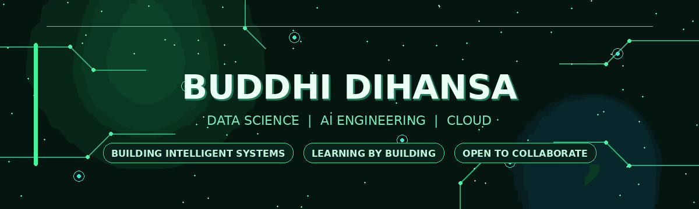

<div align="center">



<br/>

<a href="https://www.dihansa.dev"></a>
<a href="https://github.com/BuddhiDihansa"></a>
<a href="https://www.linkedin.com/"></a>

</div>

---


# Hi, I'm Buddhi 👋

**Data Science Undergraduate · Aspiring AI Engineer**

I’m a third-year BSc (Hons) Data Science undergraduate at **NSBM Green University, Sri Lanka**, interested in building practical AI systems that connect machine learning, LLM applications and cloud technologies.

- Building projects to solve real-world problems
- Exploring RAG, Agentic AI and computer vision
- Interested in reliable APIs, deployment and MLOps
- Learning through experimentation, teamwork and continuous improvement

</td>
</tr>
</table>

## `01` — What I'm working towards

```text
AI Engineering       █████████░  Building and improving
Machine Learning     ████████░░  Practising and experimenting
LLM Applications     ████████░░  RAG • Agents • Evaluation
Cloud & MLOps        ██████░░░░  Learning deployment workflows
```

## `02` — Featured projects

<table>
<tr>
<td width="50%" valign="top">

### [ASKLY](https://github.com/BuddhiDihansa/askly)
**Personalized AI Learning Assistant**

A learning-support platform combining document-based hybrid RAG with learning tools such as quizzes, flashcards, study planning and progress tracking.

`FastAPI` `Next.js` `MongoDB` `Groq` `RAG`

</td>
<td width="50%" valign="top">

### [MediGuide LK](https://github.com/BuddhiDihansa/diseases-rag-chatbot-DS205.3-coursework)
**Medical Information RAG Chatbot**

Academic group project exploring hybrid retrieval and multi-agent reasoning, with retrieval, reasoning and answer-verification components.

`FAISS` `BM25` `FastAPI` `Next.js` `Embeddings`

</td>
</tr>
<tr>
<td width="50%" valign="top">

### [ForgeSight](https://github.com/BuddhiDihansa/ForgeSight)
**Industrial Quality Inspection**

An in-progress project concept focused on computer-vision-based quality inspection and anomaly detection.

`Computer Vision` `Deep Learning` `Python`

</td>
<td width="50%" valign="top">

### [Customer Churn Prediction](https://github.com/BuddhiDihansa/churn-project)
**Explainable Machine Learning**

A customer churn prediction project using a Random Forest model and SHAP-based explanations, with an interactive Streamlit dashboard.

`Scikit-learn` `SHAP` `Pandas` `Streamlit`

</td>
</tr>
<tr>
<td width="50%" valign="top">

### [YouTube Analytics Dashboard](https://github.com/BuddhiDihansa/Youtube-Dashboard)
**Interactive Data Analytics**

A dashboard for exploring channel performance, engagement patterns and video-level metrics.

`Python` `Pandas` `Plotly` `Streamlit`

</td>
<td width="50%" valign="top">

### [Personal Portfolio](https://www.dihansa.dev)
**My work, projects and learning journey**

A personal portfolio built with a modern React-based stack.

`React` `TypeScript` `TanStack Start` `Tailwind CSS`

</td>
</tr>
</table>

## `03` — Tech stack

<div align="center">

**Languages**


**AI · Data · Backend**


**Frontend · Tools · Cloud**


</div>

> My toolkit is evolving. The technologies above reflect tools I have used, explored or am actively learning—not equal levels of proficiency.

## `04` — Currently exploring

<div align="center">


</div>

## `05` — GitHub activity

<div align="center">


</div>

## `06` — Let's connect

I’m happy to connect with fellow students, developers and people working on AI, data science and cloud projects.

<div align="center">

<a href="https://www.dihansa.dev">Website</a> ·
<a href="https://github.com/BuddhiDihansa">GitHub</a> ·
<a href="https://www.linkedin.com/">LinkedIn</a>

<br/><br/>

**“Build. Learn. Improve. Repeat.”**


</div>
